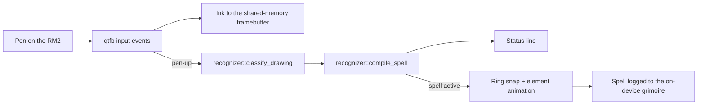

<div align="center">

# Aetherquill

**Draw a spell ring and a sigil on a reMarkable 2, and the tablet casts it in e-ink, Witch Hat Atelier style.**

[](LICENSE)
[](https://github.com/rajyyug1132/aetherquill/actions/workflows/rust.yml)
[](#contributing)

[Demo video](docs/assets/aetherquill-demo.mp4) · [Install checklist](INSTALL-CHECKLIST.md) · [Report a bug](https://github.com/rajyyug1132/aetherquill/issues)

</div>

---

## Overview

In [*Witch Hat Atelier*](https://en.wikipedia.org/wiki/Witch_Hat_Atelier),
magic is something you draw: a ring, a sigil in its center, signs around it.
Aetherquill brings that to the reMarkable 2. Draw a ring with the pen, draw a
sigil inside it, and close the ring. The tablet recognizes the glyph, compiles it
into a spell and plays the element's activation on the page.

Everything runs on the tablet itself, as a windowed app inside the stock
reMarkable UI. No phone, no screen glow, no network.

[](docs/assets/aetherquill-demo.mp4)

### Key features

* **On-device recognition.** The recognizer is a 1:1 Rust port of
  [wha-spell-simulator](https://github.com/ytnrvdf/wha-spell-simulator)'s
  pipeline (try its [web version](https://ytnrvdf.github.io/wha-spell-simulator)),
  with the same dictionaries. 85 tests check it against the vendored original
  JS, module by module, end to end, and per sign.
* **Five elements, plus signs.** Fire, water, wind, earth and light each have
  their own e-ink activation: rising flames, ripples, curling wind, rising
  earth, radiant light. Column, levitation and convergence signs change the
  compiled spell, and the status line shows by how much.
* **Spell Catalogue.** One tap inks one of 12 ready-made spells (Fire Shoot,
  Pyreball Seal, Watershot Seal, Skysoaring Seal, Water Orb, Light Beam,
  Converging Wind/Flame/Water/Light, Wind Pillar, Floating Light) and
  casts it through the same pen-up path as a hand-drawn one. Each entry is replayed stroke by stroke in the tests and must
  cast with the exact signature the original JS gives. Sources are in
  [lore.md](lore.md).
* **A real drawing surface.** Rings snap to perfect circles. Hold the pen
  still at the end of a stroke to snap it to a line, triangle, rectangle or
  circle. There's an eraser, undo/redo, and finger-drag to move strokes.
* **Safe to try.** Everything installs under `/home/root`. Nothing touches the
  system partition, `/etc` or OTA updates, and uninstalling is `rm -rf` plus a
  reboot.

---

## How it works



Recognition runs in-process on a worker thread (about 0.35 s per pen-up on the
RM2), so ink never waits on it.

### Tech stack

* **Recognizer:** pure Rust with no device dependencies. It builds and tests
  on any OS.
* **Device app:** Rust. A qtfb client for the screen, raw evdev for the pen.
  It builds as a static armv7 musl binary from plain Windows, macOS or Linux
  (no WSL, Docker or cross toolchain).
* **Tablet runtime:** [Vellum](https://github.com/vellum-dev/vellum) with
  xovi, xovi-extensions and AppLoad. The app runs windowed under a living
  xochitl.
* **Parity ground truth:** the upstream JS, vendored unmodified in
  `service/vendor/wha/` and run with Node.

---

## Getting started

> [!WARNING]
> 0.3.6 hasn't been checked on hardware yet (earlier builds have run on the
> tablet). Go through [INSTALL-CHECKLIST.md](INSTALL-CHECKLIST.md) on your
> first run, and stop at the first thing that looks wrong.

### Prerequisites

* A reMarkable 2 on OS 3.27.x (checked against 3.27.3.0).
* SSH over USB: `ssh root@10.11.99.1`. The password is under
  Settings → About → Copyrights.
* To build it yourself: Rust (stable) and bash. Plain Windows works.

### Installation

1. **Install the runtime stack on the tablet.** All of it lives in
   `/home/root`. To roll it back, run `rm -rf /home/root/.vellum /home/root/xovi`
   and reboot.

   ```sh
   # on the tablet, via SSH. Install Vellum per its README, then:
   vellum update
   vellum add xovi xovi-extensions appload
   /home/root/xovi/rebuild_hashtable
   reboot
   ```

2. **Build the bundle** on your computer:

   ```sh
   git clone https://github.com/rajyyug1132/aetherquill.git
   cd aetherquill
   rustup target add armv7-unknown-linux-musleabihf
   bash scripts/make-bundle.sh 0.3.6        # -> dist/aetherquill-0.3.6.tar.gz
   ```

   Pushing a `v*` tag builds the same bundle in CI and attaches it to a GitHub
   release (`.github/workflows/release.yml`).

3. **Install it:**

   ```sh
   scp dist/aetherquill-0.3.6.tar.gz root@10.11.99.1:/home/root/
   ssh root@10.11.99.1 "cd /home/root && tar xzf aetherquill-0.3.6.tar.gz && sh aetherquill-0.3.6/install.sh"
   ```

   `install.sh` writes only `/home/root/xovi/exthome/appload/aetherquill` and
   `/home/root/wha`. `sh install.sh --uninstall` removes both, including the
   spell log.

> [!IMPORTANT]
> xovi doesn't start by itself after a reboot. Run
> `/home/root/wha/start-xovi.sh` over SSH after each boot. It's safe to run
> twice. The screen flickers once as the UI reloads with AppLoad.

---

## Usage

Open AppLoad in the tablet UI and launch Aetherquill. Draw a big ring, then a
sigil in its center: fire, water, wind, earth or light. Sample layouts are in
`service/vendor/wha/src/dictionary/sample-spells.json`.

| Do this | And |
|---|---|
| Draw with the pen | Ink appears; recognition runs on every pen-up |
| Close a ring | It snaps to a perfect circle |
| Hold the pen still ~0.6 s at a stroke's end | The stroke snaps to a line, triangle, rectangle or circle |
| Sidebar: pen / eraser | Switch tool. The eraser deletes the strokes it touches |
| Sidebar: ↶ / ↷ | Undo / redo. Erasing and clearing can be undone too |
| Sidebar: ✕ | Clear the page |
| Sidebar: catalogue (bottom icon) | Pick one of 12 ready-made spells. The page clears, its strokes ink in and it casts. Undo removes it |
| One-finger drag on a stroke | Move it; recognition re-runs on drop |
| Close the window from AppLoad | Exit. The stock UI keeps running throughout |

Each cast is appended to `/home/root/wha/spells/log.jsonl`.

---

## Hacking on it

```
recognizer/  the ported recognition pipeline: pure Rust, zero device deps,
             compiles and tests on any OS (85 tests incl. parity)
device/      the RM2 app: qtfb client, pen input, sidebar UI, shape snapping,
             effects, Spell Catalogue. The lib half is host-testable; the
             binary is armv7-only. appload/ holds install.sh + start-xovi.sh
service/     parity ground truth: vendor/wha/ (upstream JS, never edited),
             parity-gen.mjs and catalogue-gen.mjs
scripts/     make-bundle.sh: builds the install tarball
```

```sh
cd recognizer && cargo test          # 85 tests incl. end-to-end + sign parity
cd device && cargo test --lib        # pen, shapes, effects, catalogue readback
cargo run --example effect_preview   # renders the elemental effects to a PPM

cd service && node --test            # JS-side checks
node service/parity-gen.mjs          # regenerate parity fixtures after upstream changes
node service/catalogue-gen.mjs       # regenerate device/assets/catalogue.json (JS-verified)
```

The port is deliberately 1:1 with the JS: same function names (snake_cased),
same structure, same quirks. Don't "improve" it. Matching upstream is what
keeps the parity tests meaningful. LOOP.md has the porting recipe.

---

## Roadmap

- [x] Recognizer ported to Rust, parity-tested against the original JS
- [x] On-device app: ink, ring snap, elemental effects, sidebar tools
- [x] Modifying signs (column, levitation, convergence) wired into the device flow
- [x] Redraw after suspend/resume
- [x] Spell Catalogue: every sigil x sign combo the recognizer reads back (12 spells, each jitter-tested)
- [x] Release bundle + tag-driven release workflow
- [ ] Run INSTALL-CHECKLIST.md for 0.3.6 on hardware
- [ ] Start xovi after reboot without SSH, without leaving `/home/root` (see TODOS.md)
- [ ] Port upstream's sign visuals 1:1 if its particle renderer is ever vendored

### Known issues

- The marker's eraser end isn't detected. AppLoad's qtfb bridge doesn't pass
  pen vs. eraser through, so the eraser is a sidebar toggle.
- A stroke in progress when the tablet sleeps is dropped on resume.
- One ring and one primary sigil per drawing (an upstream pipeline limit).
- Sign overlays on e-ink are Aetherquill's own drawing, since upstream's
  renderer isn't vendored. Signs read most reliably drawn in the outer band
  directly below the seal.
- E-ink animation is about 10 frames at ~12 fps with partial refreshes:
  dramatic, not smooth. Ghosting varies by panel.

---

## Contributing

Issues and PRs are welcome. Open an issue first for anything non-trivial.

- `service/vendor/wha/` is never edited. It's the parity ground truth.
- Changes to `recognizer/` must keep all 85 recognizer tests green. If upstream
  moved, regenerate fixtures with `parity-gen.mjs` in the same PR.
- For device changes, prove what you can off-device first (host tests,
  `effect_preview`), and say what was actually checked on hardware.
- Everything deployed to the tablet stays under `/home/root`. That's the
  project's safety property.

## License

Distributed under the MIT License. See [LICENSE](LICENSE).
`service/vendor/wha/` is vendored unmodified from
[ytnrvdf/wha-spell-simulator](https://github.com/ytnrvdf/wha-spell-simulator)
(MIT, see `service/vendor/wha/LICENSE`).

Aetherquill is an unofficial fan project. *Witch Hat Atelier* and related
names, artwork and terminology belong to their rights holders. Nothing here
is official or endorsed.
