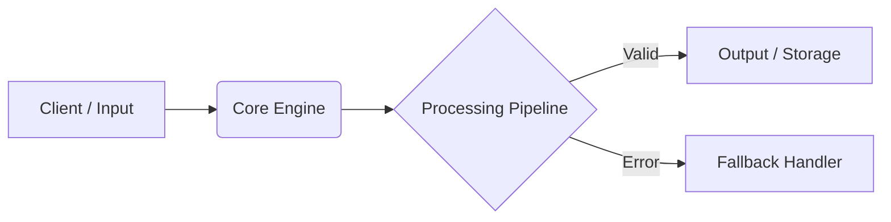

<div align="center">

# Aetherquill
**One-sentence summary of what Aetherquill does and the problem it solves.**

[](https://opensource.org/licenses/MIT)
[](https://github.com/rajyyug1132/aetherquill/actions)
[](http://makeapullrequest.com)

[Live Demo](https://example.com) · [Documentation](https://github.com/rajyyug1132/aetherquill/wiki) · [Report Bug](https://github.com/rajyyug1132/aetherquill/issues)

</div>

---

## Overview

Briefly explain **why** this project exists in 2–3 sentences. What pain point does it solve, and how does it improve upon existing workflows?


### Key Features
* **Feature 1:** Concrete description of capability and technical mechanism.
* **Feature 2:** Concrete description of capability and performance benefit.
* **Feature 3:** Concrete description of extensibility or integration.

---

## System Architecture



### Tech Stack
* **Frontend / Interface:** [e.g., Next.js, Tailwind CSS / Rust TUI]
* **Backend / Core:** [e.g., FastAPI, Node.js, Rust]
* **Data / AI:** [e.g., PostgreSQL, Ollama, LangGraph]

---

## Getting Started

### Prerequisites
* **Runtime:** Node.js v20+ / Python 3.11+ / Rust 1.80+
* **Services:** Local database or API keys

### Installation

1. **Clone the repository**
   ```bash
   git clone [https://github.com/rajyyug1132/aetherquill.git](https://github.com/rajyyug1132/aetherquill.git)
   cd aetherquill
   ```

2. **Install dependencies**
   ```bash
   npm install
   ```

3. **Configure environment variables**
   ```bash
   cp .env.example .env
   ```

   | Variable | Required | Description |
   | :--- | :---: | :--- |
   | `API_KEY` | Yes | Primary service authentication key |
   | `PORT` | No | Server port (defaults to `8080`) |

4. **Run in development mode**
   ```bash
   npm run dev
   ```

> [!IMPORTANT]
> Make sure your local service is running on port `8080` before triggering client jobs.

---

## Usage

Provide a minimal working example of how to use the library, CLI, or API:

```bash
aetherquill run --input ./sample.txt --format json
```

---

## Roadmap
- [x] Core engine implementation
- [ ] Add automated benchmark suite
- [ ] Dockerize for one-command deployment

## License
Distributed under the MIT License. See `LICENSE` for more information.
